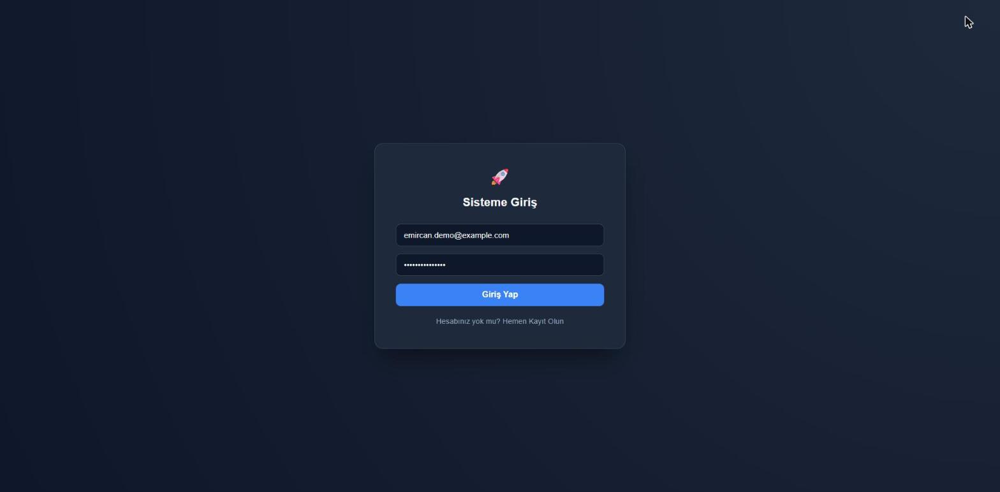
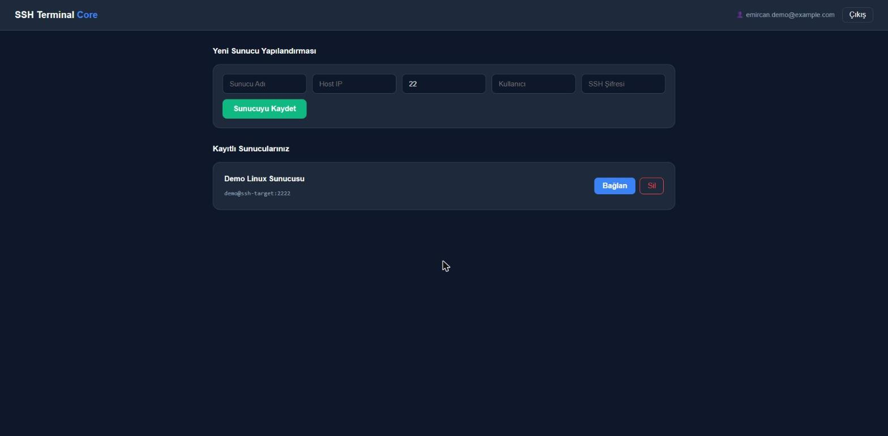
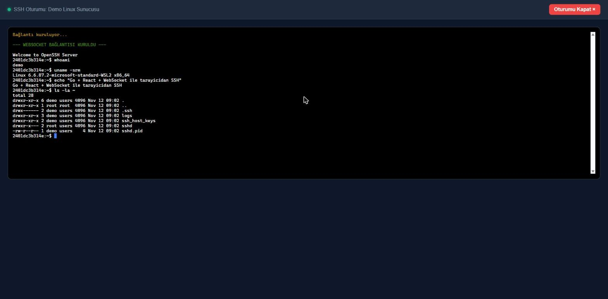

# Go-React-SSH-Terminal


A web-based SSH terminal client built with **Go** and **React**. Users sign up, save servers, and open real SSH sessions in the browser through a WebSocket bridge (xterm.js).

## Security model

| Concern | How it is handled |
|---|---|
| Authentication | JWT (HS256, 12 h expiry, algorithm pinned); all server endpoints require `Authorization: Bearer <token>` |
| Passwords | bcrypt (cost 12), 8–72 characters, constant-work login (no account enumeration by timing) |
| Brute force | Per-IP rate limit on `/login` (10 / minute) |
| Stored SSH passwords | Encrypted with **AES-256-GCM**; never returned by the API; key comes from `ENCRYPTION_KEY` |
| Authorization (IDOR) | Every connection query is scoped to the token's user; other users get `404` |
| WebSocket auth | Token is never put in a URL. The client requests a **single-use, 30 s ticket** (`POST /connections/:id/ticket`) and connects to `/ws/:ticket` |
| Host key verification | **Trust on first use**: the server fingerprint is pinned on first connect and a changed key (possible MITM) is rejected |
| CORS / WebSocket origin | Allow-list from `ALLOWED_ORIGINS`; no wildcard |
| Secrets | Read from environment variables only; the repo contains none (`.env`, `*.db` are git-ignored) |

Known limits (by design for a demo-scale project): the app connects to any host a user enters, so deploy it where outbound access is restricted (it can be used to reach internal hosts, i.e. SSRF-like exposure); the rate limiter and tickets are in-memory (single instance); there is no token revocation before expiry.

## Architecture

```
React + Vite + xterm.js  ──HTTP/JSON──▶  Go (Gin)  ──GORM──▶  SQLite
        │                                   │
        └── WebSocket (ticket) ─────────────┴──▶ golang.org/x/crypto/ssh ──▶ remote server
```

| File | Responsibility |
|---|---|
| `backend/main.go` | Wiring, routes, CORS, server start |
| `backend/config.go` | Environment configuration and validation |
| `backend/auth.go` | Register/login, JWT, auth middleware, login rate limiter |
| `backend/connections.go` | Server CRUD (user-scoped), input validation, WebSocket tickets |
| `backend/crypto.go` | AES-256-GCM helpers |
| `backend/ssh.go` | WebSocket ⇄ SSH bridge, host-key pinning |
| `backend/app_test.go` | 14 tests (auth, IDOR, encryption, tickets, CORS, host keys, config) |
| `frontend/src` | React UI (`App.jsx`, `TerminalComponent.jsx`, `api.js`) |

## API

| Method | Path | Auth | Description |
|---|---|---|---|
| GET | `/health` | – | Health check |
| POST | `/register` | – | Create account |
| POST | `/login` | – | Returns `{ token, user_id, email }` |
| GET | `/connections` | Bearer | List my servers |
| POST | `/connections` | Bearer | Add a server (`name, host, port, username, password`) |
| DELETE | `/connections/:id` | Bearer | Delete one of my servers |
| POST | `/connections/:id/ticket` | Bearer | Single-use WebSocket ticket |
| GET | `/ws/:ticket` | ticket | SSH session over WebSocket |

## Running locally

```bash
cp .env.example .env
# fill JWT_SECRET (openssl rand -base64 48) and ENCRYPTION_KEY (openssl rand -base64 32)

# Backend
cd backend
export $(grep -v '^#' ../.env | xargs)   # or set the variables in your shell
go run .

# Frontend (another terminal)
cd frontend
npm install
npm run dev        # http://localhost:5173
```

Or with Docker: `docker compose up --build` (backend on `:8080`).

The frontend reads `VITE_API_URL` (default: same host, port 8080).

## Tests and CI

```bash
cd backend && go vet ./... && go test -race ./...
cd frontend && npm run lint && npm run build
```

GitHub Actions runs formatting, vet, race-enabled tests, lint and the production build on every push and pull request.

## Screenshots

Running locally with a real SSH server as the target (Go backend + React frontend):





